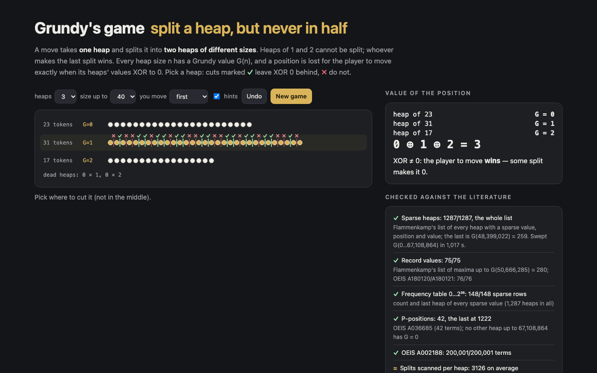

# Grundy's game

Grundy's game in the browser, with its Sprague–Grundy values. A move splits one heap into two heaps of **different** sizes; heaps of 1 and 2 cannot be split, and whoever makes the last split wins. Every heap size n has a Grundy value G(n); a position with several heaps is lost for the player to move exactly when the heaps' values XOR to 0.

Pick a heap and every place you could cut it is marked ✓ (leaves XOR 0, a winning move) or ✗; cutting exactly in half is not allowed. A computer plays the other side. Below the board: G(n) for n ≤ 30,000 with the sparse values in gold (all computed in the page in about 0.3 s), and the list of sparse heaps.



## Run it

```sh
npm install
npm run dev        # http://localhost:5173/portfolio/grundys-game/
npm test           # 11 tests
npm run build      # static site in dist/
```

## How it works

G(n) = mex { G(a) ⊕ G(n − a) : 1 ≤ a < n − a }. Taken literally that is n/2 splits per heap, O(N²) in all.

`src/grundy.ts` computes it in **sparse space** (Winning Ways, ch. 4; Flammenkamp). Call a value *common* when its bits other than the lowest have odd parity and *sparse* otherwise (mask m = 0111…10). Then common ⊕ common and sparse ⊕ sparse are sparse, and common ⊕ sparse is common. Almost every heap has a common value, so for a heap n:

1. Every common-type option comes from a split with **exactly one sparse heap**. Loop over the known sparse heaps r (about 1,300 of them) and mark G(r) ⊕ G(n − r); c is the smallest common-type value not marked.
2. Every sparse-type value below c still has to be ruled out. Scan the splits a = 1, 2, … and mark their values until all sparse-type values below c have appeared — then G(n) = c — or until the splits run out, in which case G(n) is the smallest sparse-type value that never appeared, and n is a new sparse heap.

Nothing is assumed about how long the scan in step 2 takes; it is exact. `Sweep` runs it incrementally and records the sparse heaps, record values, value frequencies, last occurrences and scan lengths.

`tools/bench.mts` times it against the definition (`runs/bench.json`): the definition takes 4× longer each time N doubles (65.5 s at N = 400,000), the sweep 2× (6.8 s).

- `src/main.ts`: the demo; the literature panel reads `src/findings.json`, written by `tools/report.mts`.
- `tools/data/flammenkamp.json`: the tables of A. Flammenkamp's page [*Sprague-Grundy Values of Grundy's Game*](https://wwwhomes.uni-bielefeld.de/achim/grundy.html) (fetched 2026-10-31): the 1287 known sparse heaps, the record values, and the frequency table for heaps 0–2³⁵.

## Checked against the literature

```sh
npm run compute    # G(0..2^26), 1,017 s in Node 26 → runs/compute.json
npm run report     # src/findings.json, and the comparison below
node tools/bench.mts
```

Heaps 0 to 2²⁶ = 67,108,864 swept in 1,017 s (one thread). Against [Flammenkamp's page](https://wwwhomes.uni-bielefeld.de/achim/grundy.html) and the OEIS:

| | source | agree |
|---|---|---|
| every sparse heap and its value | Flammenkamp's list of 1287 | **1287 / 1287**, the same list; the last is G(48,399,022) = 259 |
| record values up to 2²⁶ | Flammenkamp's list of maxima / OEIS A180120, A180121 | 75 / 75 and 76 / 76, the last G(50,666,285) = 280 |
| count and last heap of every sparse-type value | Flammenkamp's frequency table for heaps 0–2³⁵ | 148 / 148 rows |
| P-positions (G = 0) | OEIS A036685 | the same 42 heaps, the last 1222; none after, up to 2²⁶ |
| G(0..200,000) | OEIS A002188 (a-file) | 200,001 / 200,001 |

The table for 0–2³⁵ can be compared exactly on the sparse values because all of them occur below 48.4 million: no sparse heap appears between 2²⁶ and 2³⁵ in that count either.

**Where the last sparse heaps are.** 1,274 sparse heaps lie below 100,000 (the last of those is 82,860). The other 13 all lie between 47,461,861 and 48,399,022, and all have values 258–265. A value ≥ 256 can only be the XOR of two values if one of them is ≥ 256, and such heaps are still few there: the first G = 256 is at 7,250,049, and values above 256 first appear at 47,339,607 (257), 47,342,322 (262) and 47,342,972 (263). The longest scan of the sweep, at n = 47,342,435, runs to a = 7,250,049 exactly — the first heap with value 256.

**Scan length.** Ruling out the sparse values below the answer took 3,126.5 splits per heap on average (Flammenkamp: “on average 3130 common values were to check”, and 3129.46 in the statistics on the page to 2³⁸), and at most 7,250,049 up to 2²⁶ (the page gives a maximum of 50,657,340 over its whole range).

Page notes: “Calculated until January 1992: all G(n) with n ≤ 80·10⁶, which yielded the discovery of 13 new sparse values to the previously 1264 known ones.” The 13 match the 13 heaps above 100,000; below 100,000 the sweep (and the list on the page) has 1,274 sparse heaps counting n = 0, so 1264 + 13 is 10 short of the 1287 in the list.

**Tests** check the sweep against the definition up to 20,000 and in pieces, OEIS A002188 (b-file, 20,001 terms), A036685, A180120/A180121 and the first 1,274 sparse heaps up to 100,000, the xor classes of sparse space, and the XOR rule against a value-free win/lose search on all 7,338 positions of up to 24 tokens.


## License

MIT. `tests/data/` holds b-files from the OEIS (A002188, A036685, A180120, A180121), used under CC BY-SA 4.0. `tools/data/flammenkamp.json` is transcribed from Achim Flammenkamp's page linked above.

<!-- sen-publish:links -->
## Links

- 🌐 Demo: https://sen.ltd/portfolio/grundys-game/
- 📝 記事: https://qiita.com/sen-ltd/items/5202981190fbc292fec0
<!-- /sen-publish:links -->
